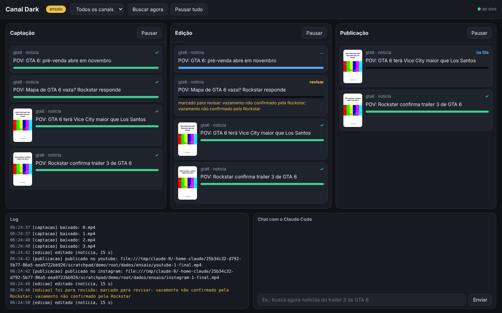

# Canal Dark

Pipeline local e 100% gratuito que encontra notícias e clipes, monta Shorts/Reels 9:16 (barras brancas, manchete, legendas palavra por palavra, narração por voz sintética) e publica no YouTube e no Instagram. Tudo aparece ao vivo num painel com três colunas: captação, edição e publicação.



- Nada pago: o "cérebro" é o **Claude Code do seu computador** (`claude -p`, usa o seu plano). Se ele não responder, entra o **Ollama** local. Voz com **Kokoro**, transcrição com **faster-whisper**, render com **FFmpeg**, upload pelas APIs oficiais gratuitas.
- Especificação: [docs/superpowers/specs](docs/superpowers/specs/2026-10-16-canal-dark-design.md) · Plano: [docs/superpowers/plans](docs/superpowers/plans/2026-10-16-canal-dark-v1.md)

## Requisitos

| O quê | Para quê | Como instalar |
|---|---|---|
| Python 3.11+ | o programa | python.org ou `brew install python` |
| FFmpeg (com libass) | edição dos vídeos | `brew install ffmpeg` · `sudo apt install ffmpeg` |
| Claude Code logado | manchetes, roteiros, triagem e chat | `npm install -g @anthropic-ai/claude-code` e rode `claude` uma vez |
| Ollama (opcional) | reserva quando o Claude Code está no limite | ollama.com, depois `ollama pull qwen2.5:7b` |
| cloudflared (opcional) | só se preferir enviar ao Instagram por link público | `brew install cloudflared` |

## Instalação

```bash
git clone https://github.com/Andrelbmachado/Canal-Dark.git
cd Canal-Dark
python3 -m venv .venv && source .venv/bin/activate
pip install -e ".[ml]"      # [ml] traz a voz Kokoro e a transcrição (faster-whisper)
```

Sem o `[ml]` o painel roda, mas a etapa de edição para com a mensagem "voz Kokoro não instalada".

Problemas comuns no macOS:
- Use **Python 3.12** para o `[ml]` (com 3.13/3.14 a voz Kokoro não compila). Com o uv: `uv python install 3.12` e `uv venv --python 3.12 .venv`.
- Se aparecer `No module named 'canaldark'` com o projeto dentro de Documentos, o macOS ocultou arquivos do venv. Rode `chflags nohidden .venv/lib/python3.12/site-packages/*.pth`.

## Primeiro uso: ensaio

```bash
canaldark run --ensaio
```

Abra http://localhost:8000. O ensaio faz tudo (busca, baixa, edita) mas, em vez de publicar, copia os MP4 para `dados/ensaio/`. Assista a alguns antes de ligar a publicação.

## Ligar a publicação

1. Siga [docs/contas.md](docs/contas.md) para criar, de graça, o acesso ao YouTube e ao Instagram.
2. Conecte cada conta usada em `contas:` nos arquivos de `canais/`:
   ```bash
   canaldark auth youtube gta6
   canaldark auth instagram gta6 --ig-user-id 1784...
   ```
   Os tokens ficam no chaveiro do sistema, nunca no repositório.
3. Rode de verdade: `canaldark run`

## Canais

Cada arquivo em `canais/` é um canal: fontes, pesos de formato (`noticia`, `meme`, `dialogo`), estilo da manchete, voz, horários e contas. Vêm três prontos: `gta6.yaml`, `ia.yaml` e `politica.yaml`. O de política usa `regras: politica`: só fontes jornalísticas, sem meme, rótulo de IA e pausa automática de 22 a 26/10/2026 (janela do TSE do 2º turno). Os feeds RSS incluídos não foram testados daqui; um feed quebrado só gera um aviso no log.

Extras opcionais:
- `sons/catalogo.yaml` + arquivos em `sons/`: sons que o cérebro pode escolher (use só áudios que você tem direito de usar).
- `personagens/<nome>.png`: imagem de cada personagem do formato diálogo (crie personagens originais).

## Painel e chat

Cada card mostra a barra de progresso da etapa, ✓ quando concluiu e ✗ com o botão "Tentar de novo" quando falhou. Vídeos com dúvida de direitos ou veracidade param em **revisar** até você aprovar ou descartar. No chat, fale com o Claude Code: "busca agora o trailer 3", "pausa a publicação até amanhã 9h", "refaz a manchete do vídeo 12 mais curta". Aprovar, descartar, publicar agora e adicionar fonte sempre pedem sua confirmação.

## Testes

```bash
pip install -e ".[dev]"
pytest
```
