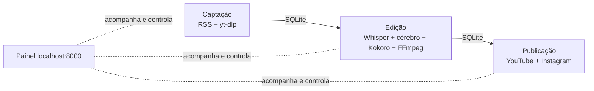

# Canal Dark 🎬🤖

**Um canal "dark" (sem rosto) operado por IA, rodando no seu próprio computador: ele capta notícias e clipes, gera Shorts 9:16 com valor original (manchete, narração, legendas e fonte) e publica sozinho no YouTube e no Instagram, sem pagar nenhuma API.**

> [!IMPORTANT]
> **Status: em planejamento. Ainda não existe código neste repositório.**
> Tudo o que está descrito abaixo é **planejado**: é o que a v1 vai entregar, conforme a [especificação](docs/superpowers/specs/2026-10-16-canal-dark-design.md) e o [plano de implementação v1](docs/superpowers/plans/2026-10-16-canal-dark-v1.md). O andamento real está no **[PLANO.md](PLANO.md)**.

---

## O que existe hoje

| Item | Situação |
|---|---|
| Especificação aprovada (16/10/2026) | ✅ pronta: [resumo](docs/superpowers/specs/2026-10-16-canal-dark-design.md) |
| Plano de implementação v1 (12 tarefas, com testes) | ✅ pronto: [plano](docs/superpowers/plans/2026-10-16-canal-dark-v1.md) |
| Roteiro por fases e checklist | ✅ pronto: [PLANO.md](PLANO.md) |
| Canal no YouTube e contas de API | ⏳ a fazer (Fase 0) |
| Programa `canaldark` | 🔜 planejado (Fase 1) |

## Como vai funcionar (planejado)



1. **Captação** lê fontes por canal (Google News, feeds de canais do YouTube, Reddit, RSS), o cérebro dá nota e agrupa notícias do mesmo fato, e o `yt-dlp` baixa o clipe.
2. **Edição** transcreve com faster-whisper, o cérebro escreve manchete, roteiro, título e hashtags, o Kokoro narra em PT-BR e o FFmpeg renderiza um Short 1080x1920 com barras brancas, manchete e legendas palavra a palavra.
3. **Publicação** envia nos horários configurados pela API gratuita do YouTube e pela Graph API do Instagram (Reels), respeitando limites diários.
4. **Painel web** com 3 colunas (captação, edição, publicação), barras de progresso, histórico com ✓, log ao vivo e chat com o Claude Code para comandar o canal ("busca agora", "refaz a manchete", "pausa até amanhã").

### Formatos de vídeo (planejado)

| Formato | Duração | O que é |
|---|---|---|
| `noticia` | 15–40 s | Clipe + manchete + narração com a fonte citada |
| `meme` | 7–15 s | Corte curto com manchete e efeito sonoro |
| `dialogo` | 30–60 s | Explicação em diálogo entre personagens, quando a notícia não tem vídeo |

## Princípios

- **Nada pago.** O "cérebro" é o Claude Code já logado no seu PC (`claude -p`), com Ollama local de reserva. Sem SaaS, sem chave paga.
- **Valor original sempre.** Todo vídeo tem manchete, narração ou legenda e fonte, para não cair na política de "conteúdo reutilizado" do YouTube.
- **Tudo local.** Um comando só sobe as três etapas e o painel; tokens OAuth ficam no keyring do sistema, nunca no repositório.
- **Política com freio.** Canais com `regras: politica` usam só fontes jornalísticas, não fazem meme, mandam opinião para a fila "revisar" e pausam sozinhos na janela do TSE (22 a 26/10/2026).
- **Um canal = um YAML.** O primeiro canal é **GTA 6**; IA e política entram só adicionando arquivos em `canais/`.

## Como vai rodar (planejado — os comandos ainda não existem)

Requisitos previstos: macOS ou Linux, Python 3.11+, FFmpeg com libass, `cloudflared` (para o Instagram buscar o vídeo), Claude Code logado e, opcionalmente, Ollama com `qwen2.5:7b`.

```bash
pip install -e .
canaldark run --ensaio            # simula tudo e salva os MP4 em dados/ensaio/, sem publicar
canaldark auth youtube gta6       # conecta a conta do YouTube (OAuth)
canaldark auth instagram gta6     # conecta a conta do Instagram
canaldark run                     # roda de verdade; painel em http://localhost:8000
```

## Tecnologias previstas

Python 3.11 · asyncio · FastAPI + WebSocket · SQLite (aiosqlite) · yt-dlp · faster-whisper · Kokoro TTS · FFmpeg · YouTube Data API v3 · Instagram Graph API · Cloudflare Tunnel · MCP · pytest. Frontend em HTML/CSS/JS puro, sem build.

## Próximo passo

**Fase 0: criar o canal e liberar as APIs** (conta Google dedicada, canal GTA 6, projeto no Google Cloud com a YouTube Data API v3). O checklist completo, com critério de pronto para cada item, está no **[PLANO.md](PLANO.md)**.

## Documentação

- [PLANO.md](PLANO.md) — fases, checklist e critérios de pronto
- [Especificação (resumo)](docs/superpowers/specs/2026-10-16-canal-dark-design.md) — decisões do produto, com link para a versão completa
- [Plano de implementação v1](docs/superpowers/plans/2026-10-16-canal-dark-v1.md) — 12 tarefas com interfaces e testes
